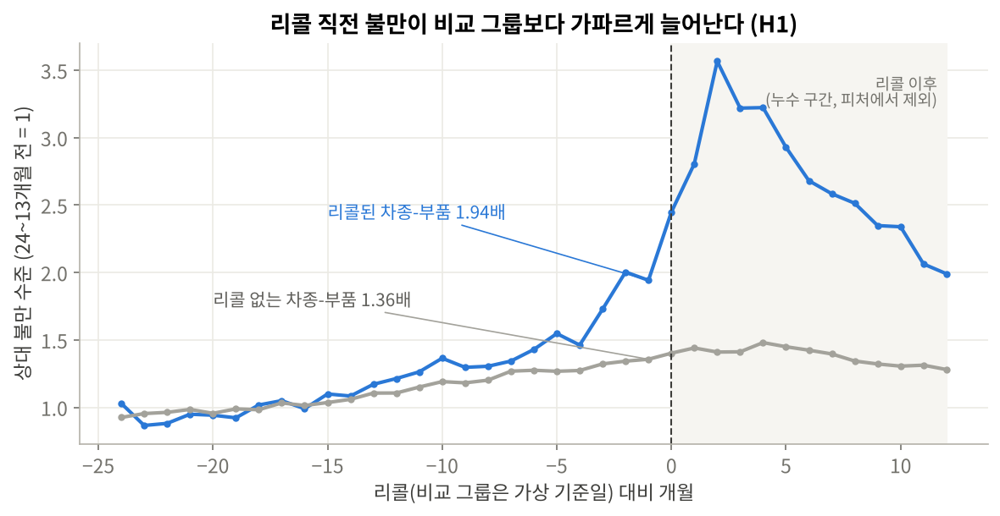
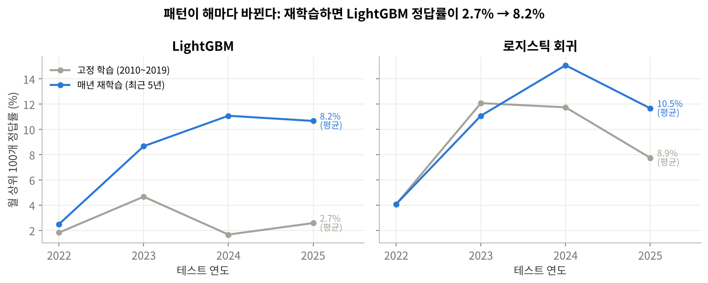
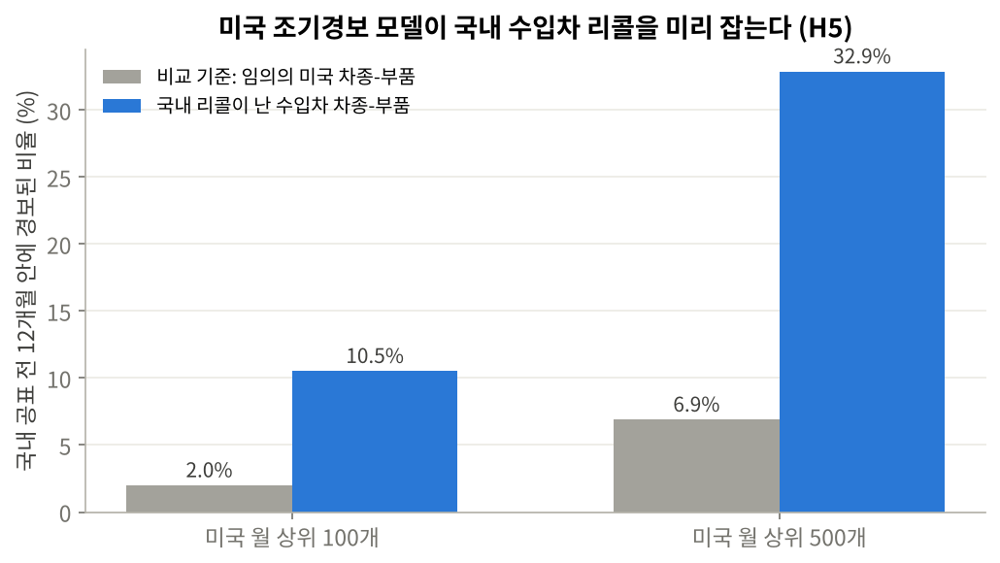

# Car-recall-dicision
산업데이터 분석 팀플 - 리콜 예측 및 결정


미국 NHTSA 고객 불만(Complaints)과 리콜(Recalls) 공개 데이터로
(1) 리콜 직전 불만 신호가 있는지, (2) 6개월 안에 리콜될 차종-부품을 미리 고를 수 있는지,
(3) 리콜이 다른 연식으로 확대될지 예측할 수 있는지를 분석합니다.

## 데이터 (저장소에 포함하지 않음)
`data/` 폴더에 아래 파일을 내려받아 압축을 풉니다.
- 불만: https://static.nhtsa.gov/odi/ffdd/cmpl/FLAT_CMPL.zip (컬럼 설명: CMPL.txt)
- 리콜: https://static.nhtsa.gov/odi/ffdd/rcl/FLAT_RCL_POST_2010.zip (컬럼 설명: RCL.txt)

## 실행
```bash
pip install pandas numpy scikit-learn lightgbm
python src/overlap.py data        # 리콜 전후 불만 추이
python src/control.py data        # 리콜 없는 차종-부품과 비교
python src/build_panel.py data    # 차종-연식-부품 x 월 패널 + 6개월 리콜 라벨
python src/train.py data          # 규칙 / 로지스틱 / LightGBM
python src/expansion.py data      # 리콜 범위 확대 예측
python src/text_features.py data  # 불만 텍스트 키워드·토픽 (메모리 약 4GB)
python src/train_text.py data     # 텍스트 추가 효과(H2) 검증
python src/drift.py data          # 재학습 전략 비교(개념 드리프트)
python src/expansion.py data fine # 확대 예측, 세부 부품명 기준 라벨
CONSUMER24_KEY=발급키 python src/fetch_kr_recall.py   # (선택) 소비자24 국내 자동차 리콜 수집
python src/kr_vs_us.py data/kr_recall_auto.csv data         # 한·미 리콜 비교 (H4)
python src/us_model_to_kr.py data data/kr_recall_auto.csv   # 미국 모델로 국내 수입차 리콜 사전 포착 (H5)
python src/figures.py data figures                          # 발표용 그래프

# ---- 검증 보강 (감사 결과 반영) ----
python src/manual_verify.py data/kr_recall_auto.csv data           # 한·미 매칭 수기 검증표 생성 -> same_defect 열에 Y/N/? 입력
python src/manual_verify.py data/kr_recall_auto.csv data score     # 입력 결과로 진매칭률(precision) 계산
python src/ablation.py data                                        # LightGBM 폭락 원인 분해 (피처 묶음 제거 실험)
python src/add_prr.py data && python src/ablation.py data prr      # PRR(비례보고비율) 피처 추가 실험
python src/triage.py data data/kr_recall_auto.csv                  # 오경보 해부 + 2단계 선별 큐 + 수입차 워치리스트
python src/case_study.py data BMW X5 2019 "ELECTRICAL SYSTEM" 202603   # 차종-부품 사례 타임라인 그림
```

## 설정
- 키: 제조사 + 차종(영숫자만) + 연식 + 부품 상위 분류(COMPDESC 콜론 앞)
- 라벨: 다음 6개월 안에 같은 키로 리콜 접수(RCDATE)
- 대상: 최근 12개월 불만 1건 이상인 키-월. 리콜 직후 12개월은 제외(누수 방지)
- 분할: 학습 2010~2019 / 검증 2020~2021 / 테스트 2022.01~2026.03

## 결론
> **질문:** 고객 불만 데이터로 자동차 리콜을 미리 알 수 있는가?
> **답:** 부분적으로 가능하다. 미국 불만 데이터로 6개월 안에 리콜될 차종-부품의 **위험 순위**를 무작위보다 약 11배 정확하게 매길 수 있고,
> 해마다 패턴이 바뀌므로 **매년 재학습**해야 한다. 이 미국 모델은 **국내 수입차 리콜**도 공표 전에 경보하며(비교 기준의 약 5배),
> 실제 미국 리콜은 국내 리콜보다 **중간값 2개월 먼저** 난다. 불만 데이터는 "리콜을 맞히는 도구"보다 **"어디를 먼저 볼지 정하는 우선순위 도구"**다.



## 모델 1. 리콜 조기경보 = 이산시간 위험모형 (`build_panel.py`, `train.py`)
차종-연식-부품 × 월 패널에서 "6개월 안에 리콜되는가"를 예측. 테스트 2022.01~2026.03, 월 후보 약 2.6만 개, 정답 0.86%.

| 모델 | PR-AUC | 월 상위 100개 정답률 | 월 상위 500개로 잡은 리콜 |
|---|---|---|---|
| 규칙 (최근 3개월 불만 수) | 0.015 | 4.0% | 9.4% |
| **로지스틱 회귀** | **0.043** | **9.5%** | **18.9%** (중간값 6개월 전) |
| LightGBM (고정 학습) | 0.034 | 3.1% | 14.0% |

### 개념 드리프트와 재학습 (`drift.py`)
연도별 테스트(2022~2025) 평균, 월 상위 100개 정답률:

| 학습 전략 | 로지스틱 | LightGBM |
|---|---|---|
| 고정 학습 (2010~2019) | 8.9% | 2.7% |
| 매년 재학습, 전체 누적 | 10.5% | 8.8% |
| **매년 재학습, 최근 5년** | **10.5%** | **8.2%** |

LightGBM이 진 이유는 모델이 아니라 **드리프트**였다. 예: 에어백 리콜 비율 2015년 5.5% → 2024년 1.8% (다카타 사태 이후), 전기계통은 상승.


## 한·미 연결 (`fetch_kr_recall.py`, `kr_vs_us.py`, `us_model_to_kr.py`)
소비자24 자동차 리콜 OpenAPI(2025.05~2026.11, 국토부 424건). 국내 리콜 원자료는 API 키가 필요해 저장소에 포함하지 않음.
- **H4 미국 리콜이 국내 리콜보다 먼저 난다:** 같은 브랜드·차종명·부품 매칭 86건 중 72건(84%)이 미국 먼저, 중간값 2개월
- **H5 미국 조기경보 모델이 국내 수입차 리콜을 미리 잡는다:** 미국 키가 있는 국내 수입차 리콜 76건 중
  월 상위 500개 경보 33% (비교 기준 6.9%), 상위 100개 경보 10.5% (비교 기준 2.0%)


## 모델 2. 리콜 범위 확대 예측 (`expansion.py`) — 보조 결과
한 연식 리콜 후 주변 연식(±3년)이 12개월 안에 리콜되는지 예측.
| 확대 판정 기준 | 12개월 내 확대된 리콜 | 테스트 기본 비율 | 로지스틱 PR-AUC | 상위 20%로 잡은 확대 |
|---|---|---|---|---|
| 부품 상위 분류 일치 (느슨) | 20.6% | 8.7% | 0.171 | 44% |
| **세부 부품명 일치 (엄격)** | **7.5%** | **2.7%** | **0.037** | **34%** |

느슨한 기준은 무관한 결함이 섞여 결과가 부풀려졌다. 엄격한 기준에서는 예측력이 약하므로 확대 예측은 보조 결과로만 쓴다.
NHTSA 조사로 시작된 리콜은 확대율이 더 높다(엄격 기준 7.4% vs 제조사 자체 2.5%).

## 가설 검증
| 가설 | 결과 |
|---|---|
| H1 불만 증가가 리콜보다 먼저 나타난다 | 지지 (직전 1.94배 vs 비교 그룹 1.36배) |
| H2 불만 텍스트를 추가하면 예측이 좋아진다 | 기각 (PR-AUC 0.0429 → 0.0431, 신뢰구간 겹침) |
| H3 심각도가 높을수록 리콜 가능성이 높다 | 부분 지지 (기여 작음) |
| H4 미국 리콜은 국내 리콜의 선행 신호다 | 지지 (84%가 미국 먼저, 중간값 2개월) |
| H5 미국 조기경보 모델로 국내 수입차 리콜에 미리 대비할 수 있다 | 지지 (비교 기준의 약 5배 경보) |
| 추가: 리콜 확대는 예측 가능하다 | 엄격 기준에서 약함 |

## 한계
- 불만과 같은 키로 연결되는 미국 리콜은 약 25% (리콜의 약 90%가 제조사 자체 시작)
- 판매량 보정 없음
- 한·미 매칭은 브랜드+차종명+부품 분류 기준 → 결함 내용이 다른 리콜이 섞일 수 있음, 표본 작음(76~86건)
- 국내 데이터는 최근 1년 반치, 미국 점수는 2026.03까지라 그 뒤 국내 리콜은 경보 창이 짧음
- 예측력은 인과가 아님

그래프 전체: `figures/`


## 검증 보강 내역 (코드 감사 반영)
| 문제 | 수정 |
| --- | --- |
| `train.py`·`train_text.py` 분할 경계에 6개월 엠바고 없음 (라벨 (t,t+6]) | 학습 <=2019-06 / 검증 2020-01~2021-06 / 테스트 >=2022-01 |
| `expansion.py` 12개월 라벨 엠바고 없음, 우측 중도절단, 초기 리콜 당월 불만 혼입 | 학습 m0<=2017-12 / 검증 2019~2020 / 테스트 m0>=2022-01, `m0+12 > 마지막 리콜월` 제외, 불만은 m0 이전만 사용 |
| `text_features.py` 대문자 텍스트 + `lowercase=False` -> 불용어 미제거 | 불용어를 대문자로 변환 + 콜센터 상용구 제거 |
| 같은 불만(ODINO)의 하위 부품 중복 집계 | `build_panel.py`·`text_features.py`·`expansion.py`에서 ODINO 기준 중복 제거 |
| `overlap.py`·`control.py` 하드코딩 경로, `us_model_to_kr.py`의 `eval()` | `{data}/` 인자 사용, 공통 모듈 `kr_common.py` import |
| `drift.py` LightGBM 설정이 `train.py`와 다름 (200트리 고정) | 동일 파라미터 + early stopping(학습 창 마지막 12개월 검증, 6개월 엠바고) |
| H4 비대칭 탐색 창(-3년/+1년) | `kr_vs_us.py`가 대칭 창(±6/12/24개월)·우측 절단 제외 민감도 표 출력 |
| H5 비교 기준 불일치(다중 키 합집합 vs 단일 키) | 같은 그룹을 다른 달에 평가하는 placebo, 1단계/2단계 분리, 리드타임 분포 출력 |

> 주의: 위 수정 후에는 **모든 수치(README·Notion·그래프)를 다시 계산**해야 합니다. `results/`의 기존 파일은 수정 전 결과입니다.
